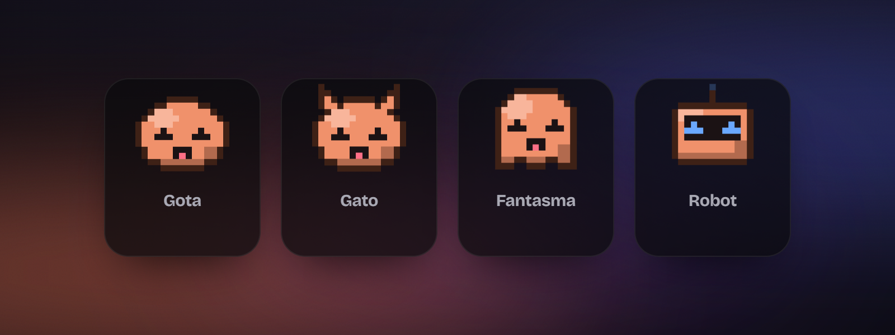

<div align="center">


# Notch Pet

**Una mascota que vive en el borde de tu pantalla y vigila tus sesiones de Claude Code.**

Te dice qué está haciendo cada sesión, te avisa cuando una te necesita y cuando termina,
y te deja contestarle sin abrir nada. Para Windows.

</div>

---

<p align="center"></p>

## Qué hace

- **Ves tus sesiones de un vistazo.** Las últimas sesiones de Claude Code (las de la terminal y las de la pestaña Code de la app de Claude), con su nombre, qué están haciendo ahora mismo y su último mensaje con formato.
- **Te avisa cuando una te necesita.** La mascota se pone naranja y tiembla, suena un aviso y sale una notificación de Windows.
- **Te cuenta cuándo ha terminado.** Si llevas varias sesiones a la vez, el notch se despliega solo unos segundos con el resumen de la que ha acabado.
- **Responde lo que te pide sin cambiar de ventana.** Permitir o denegar una herramienta (con «Permitir siempre» si Claude lo propone), elegir entre las opciones de una pregunta o aprobar un plan, desde el propio notch. Si contestas en la ventana de Claude, el notch lo retira solo.
- **Le escribes desde el notch, con fotos.** El mensaje entra en esa misma conversación; pega una imagen con Ctrl+V, arrástrala o adjúntala con el botón (hasta 4).
- **Lo pones donde quieras.** Mantén pulsada la barra del notch y arrástralo por la parte de arriba de la pantalla; se queda ahí. En **Ajustes → Notch** lo vuelves a centrar.
- **Un clic y la abres.** El botón de abrir te lleva a esa sesión en la app de Claude (o a su carpeta en VS Code, la terminal o el Explorador).
- **Tiene personalidad.** Duerme, se aburre, se impacienta si la haces esperar, se pone gafas cuando lee y un lápiz cuando edita, y engorda un poco con cada sesión que termina en el día. Hazle cosquillas.
- **En tu idioma.** Español, inglés, francés, alemán, italiano, portugués, japonés, chino, coreano y ruso. Por defecto usa el de Windows; se cambia en **Ajustes → General**.

| Trabajando | Te necesita | Ha terminado |
|:--:|:--:|:--:|
|  |  |  |

### Elige tu mascota

<p align="center"></p>

Y **Garabato**: una mascota dibujada a mano, con un trazo que tiembla un poco como una animación en papel y las mismas caras y accesorios.

También en **8 bits**: en Ajustes → Mascota eliges el estilo, *Suave* o *8 bits*, con las mismas caras, humores y accesorios.

<p align="center"></p>

O usa tu propia imagen (PNG, GIF animado o WebP con fondo transparente). Los colores también se cambian.

### Ajustes

<p align="center">
  
  
</p>

## Cómo funciona

1. **Lee tus conversaciones de Claude Code** (`~/.claude/projects`) cada pocos segundos. Con eso ya ve tus sesiones, su título y si están trabajando o han terminado.
2. **Opcionalmente, con los hooks de Claude Code**, se entera al instante de cada paso y, sobre todo, de cuándo una sesión te pide permiso. El hook `PermissionRequest` espera tu respuesta desde el notch y se la pasa a Claude; corre a la vez que el diálogo de siempre, así que gana lo que contestes primero. Se instalan y se quitan con un botón desde los ajustes; solo se tocan las entradas de Notch Pet y antes se guarda una copia de tu `settings.json`.
3. **Para contestar** usa el comando `claude` de tu equipo (`claude -p --resume <sesión>`), así que necesita Claude Code instalado y con la sesión iniciada.

Todo ocurre en tu equipo: Notch Pet no envía nada a ningún servidor. Los hooks hablan con la app por `127.0.0.1`.

## Descargar

Descarga el instalador (`NotchPet-Setup-x.y.z.exe`) desde la [última versión](https://github.com/RubenMRDev/notch-pet/releases/latest) y sigue el asistente: eliges la carpeta, crea el acceso directo en el escritorio y arranca al terminar.

**Se actualiza sola.** Al abrirse y cada 4 horas mira si hay una versión nueva; en **Ajustes → General** la descargas cuando quieras y, al reiniciar, se instala en silencio y vuelve a abrirse. El instalador se comprueba con su huella SHA-512 antes de usarlo.

> El instalador no está firmado, así que Windows SmartScreen avisará la primera vez: pulsa **Más información → Ejecutar de todas formas**.

## Instalar desde el código

Necesitas [Node.js](https://nodejs.org) 20 o superior.

```bash
git clone https://github.com/RubenMRDev/notch-pet.git
cd notch-pet
npm install
npm start
```

| Comando | Qué hace |
|---|---|
| `npm start` | Arranca la mascota |
| `npm test` | Comprueba estados, hooks, conversaciones, actualizaciones, respuestas a permisos, idiomas y la interfaz del notch |
| `npm run dist` | Genera el instalador de Windows en `dist/` |

La primera vez se abren los ajustes en **Conexión con Claude** para que instales los hooks. El atajo `Ctrl + Alt + N` deja el notch abierto aunque quites el ratón.

## Estructura

| Fichero | Qué es |
|---|---|
| `main.js` | Proceso principal: ventanas, bandeja, servidor local de eventos, avisos |
| `preload.js` | Puente seguro entre las ventanas y el proceso principal |
| `state.js` | Estado de las sesiones, humor de la mascota y estadísticas del día |
| `recover.js` | Lectura de las conversaciones de `~/.claude/projects` |
| `hooks.js` · `hook.js` | Instalar/quitar los hooks y el script que manda cada evento |
| `asks.js` | Permisos, preguntas y planes: cómo se muestran y la respuesta que espera Claude |
| `updater.js` | Actualizaciones desde las releases de GitHub |
| `index.html` · `notch.js` · `notch.css` | El notch |
| `settings.html` · `settings.js` · `settings.css` | La ventana de ajustes |
| `pet.css` · `shared.js` | La mascota, los iconos y las traducciones del lado de las ventanas, compartidos |
| `i18n.js` · `locales/` | Los 10 idiomas: un JSON por idioma con las mismas claves |
| `promo/` | Escena de demostración con la que se generan las imágenes y el vídeo |
