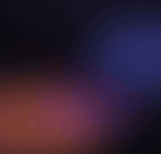
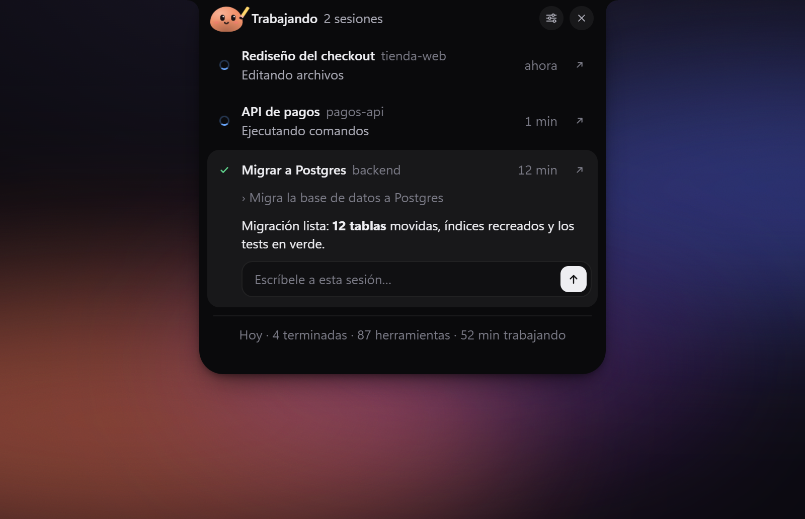
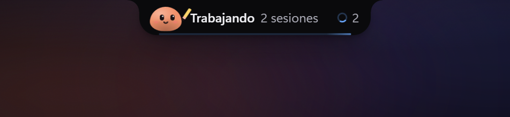
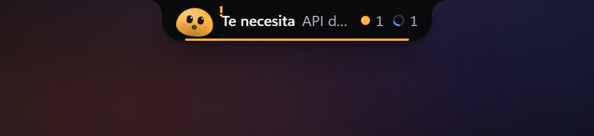
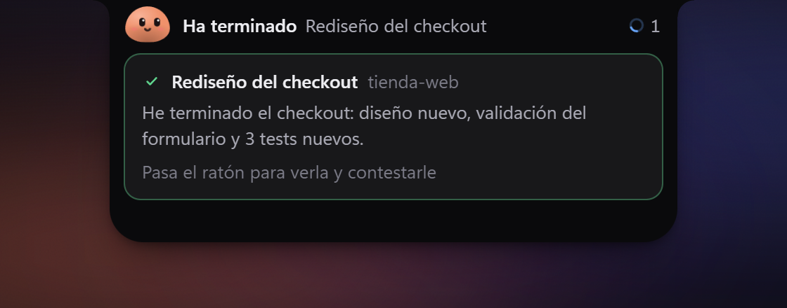
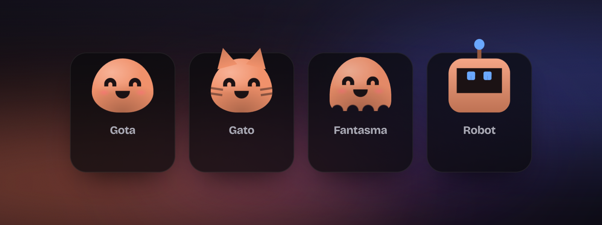
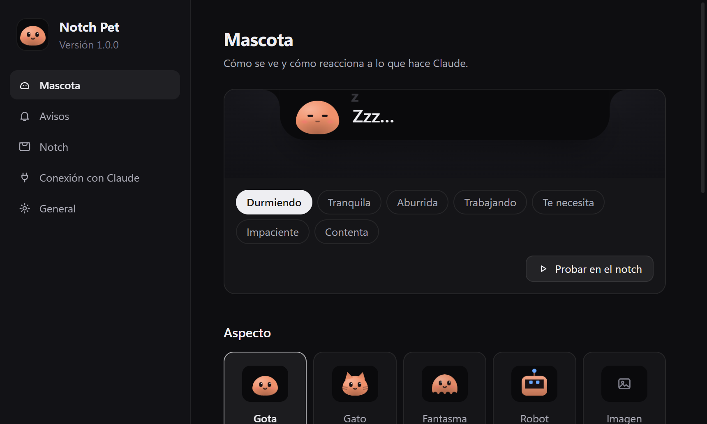
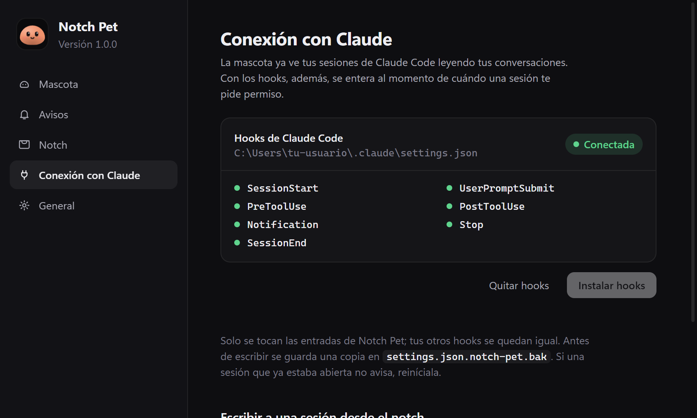

<div align="center">



# Notch Pet

**Una mascota que vive en el borde de tu pantalla y vigila tus sesiones de Claude Code.**

Te dice qué está haciendo cada sesión, te avisa cuando una te necesita y cuando termina,
y te deja contestarle sin abrir nada. Para Windows.

</div>

---

<p align="center"></p>

## Qué hace

- **Ves tus sesiones de un vistazo.** Las últimas sesiones de Claude Code (las de la terminal y las de la pestaña Code de la app de Claude), con su nombre, qué están haciendo ahora mismo y su último mensaje con formato.
- **Te avisa cuando una te necesita.** La mascota se pone naranja y tiembla, suena un aviso y sale una notificación de Windows.
- **Te cuenta cuándo ha terminado.** Si llevas varias sesiones a la vez, el notch se despliega solo unos segundos con el resumen de la que ha acabado.
- **Le contestas desde el notch.** Escribes en la sesión y el mensaje entra en esa misma conversación.
- **Un clic y la abres.** El botón de abrir te lleva a esa sesión en la app de Claude (o a su carpeta en VS Code, la terminal o el Explorador).
- **Tiene personalidad.** Duerme, se aburre, se impacienta si la haces esperar, se pone gafas cuando lee y un lápiz cuando edita, y engorda un poco con cada sesión que termina en el día. Hazle cosquillas.

| Trabajando | Te necesita | Ha terminado |
|:--:|:--:|:--:|
|  |  |  |

### Elige tu mascota

<p align="center"></p>

O usa tu propia imagen (PNG, GIF animado o WebP con fondo transparente). Los colores también se cambian.

### Ajustes

<p align="center">
  
  
</p>

## Cómo funciona

1. **Lee tus conversaciones de Claude Code** (`~/.claude/projects`) cada pocos segundos. Con eso ya ve tus sesiones, su título y si están trabajando o han terminado.
2. **Opcionalmente, con los hooks de Claude Code**, se entera al instante de cada paso y, sobre todo, de cuándo una sesión te pide permiso. Se instalan y se quitan con un botón desde los ajustes; solo se tocan las entradas de Notch Pet y antes se guarda una copia de tu `settings.json`.
3. **Para contestar** usa el comando `claude` de tu equipo (`claude -p --resume <sesión>`), así que necesita Claude Code instalado y con la sesión iniciada.

Todo ocurre en tu equipo: Notch Pet no envía nada a ningún servidor. Los hooks hablan con la app por `127.0.0.1`.

## Descargar

Descarga **`NotchPet-Setup-1.0.0.exe`** desde la [última versión](https://github.com/RubenMRDev/notch-pet/releases/latest), ábrelo y listo: se instala para tu usuario y arranca sola.

> El instalador no está firmado, así que Windows SmartScreen avisará la primera vez: pulsa **Más información → Ejecutar de todas formas**.

## Instalar desde el código

Necesitas [Node.js](https://nodejs.org) 20 o superior.

```bash
git clone https://github.com/RubenMRDev/notch-pet.git
cd notch-pet
npm install
npm start
```

| Comando | Qué hace |
|---|---|
| `npm start` | Arranca la mascota |
| `npm test` | Comprueba la lógica de estados, hooks y lectura de conversaciones |
| `npm run dist` | Genera el instalador de Windows en `dist/` |

La primera vez se abren los ajustes en **Conexión con Claude** para que instales los hooks. El atajo `Ctrl + Alt + N` deja el notch abierto aunque quites el ratón.

## Estructura

| Fichero | Qué es |
|---|---|
| `main.js` | Proceso principal: ventanas, bandeja, servidor local de eventos, avisos |
| `preload.js` | Puente seguro entre las ventanas y el proceso principal |
| `state.js` | Estado de las sesiones, humor de la mascota y estadísticas del día |
| `recover.js` | Lectura de las conversaciones de `~/.claude/projects` |
| `hooks.js` · `hook.js` | Instalar/quitar los hooks y el script que manda cada evento |
| `index.html` · `notch.js` · `notch.css` | El notch |
| `settings.html` · `settings.js` · `settings.css` | La ventana de ajustes |
| `pet.css` · `shared.js` | La mascota y los iconos, compartidos |
| `promo/` | Escena de demostración con la que se generan las imágenes y el vídeo |
